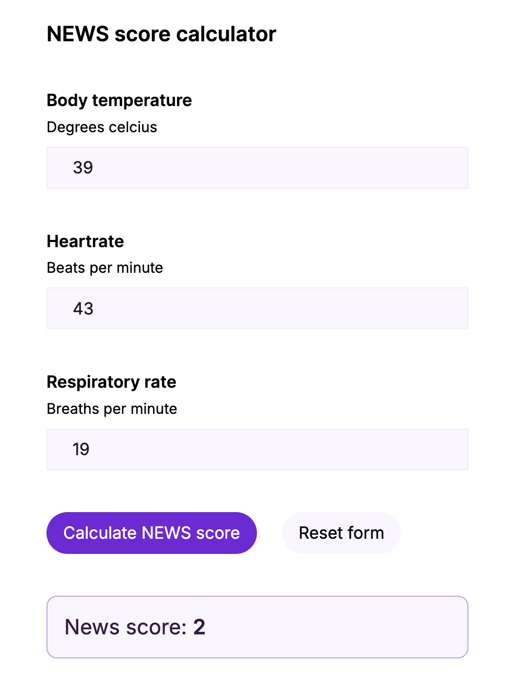
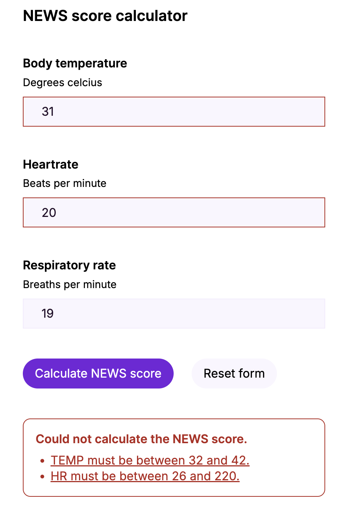
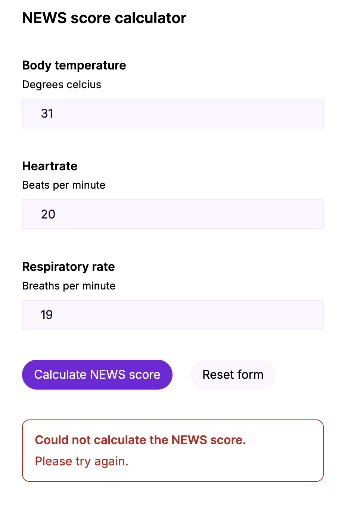

# NEWS Score

A micro web application that calculates a simplified NEWS score from three vital signs (temperature, heart rate, respiratory rate).
It is built with an ASP.NET Core minimal API and a Next.js (TypeScript) frontend.

## What it does

A nurse enters three measurements. The form sends them to the API, which validates them and returns a single NEWS score.

- **Backend** (`backend/`): `POST /api/news-score` validates the measurements and returns `{ "score": number }`, or `400` with per-field errors in the ProblemDetails format. The score bands live only here, as data.
- **Frontend** (`frontend/`): the form from the Figma sketches, with submit and reset. It never calculates anything. It sends the values and shows the score or the errors it gets back.

The scoring follows the spec: each measurement gets a score from its range table (start exclusive, end inclusive), and the NEWS score is the sum of the three.



## How to run

### Prerequisites

- [.NET 10 SDK](https://dotnet.microsoft.com/download)
- [Node.js](https://nodejs.org/) 22.12 or later (the current LTS is recommended)

### Backend

```bash
cd backend
dotnet run --project src/NewsScore.Api
```

The API runs on <http://localhost:5080>. Check it with `curl http://localhost:5080/health`, which should return `Healthy`.

### Frontend

In a second terminal:

```bash
cd frontend
cp .env.example .env.local
npm install
npm run dev
```

Open <http://localhost:3000>.

`.env.local` sets `API_BASE_URL` (default `http://localhost:5080`). Next.js forwards `/api/*` to that address, so the browser only talks to one origin and the API needs no CORS setup. The app refuses to start if the variable is missing.

### Tests

```bash
cd backend && dotnet test        # 80 tests: calculator, validator, HTTP endpoint
cd frontend && npm test          # 17 tests: form behaviour + automated accessibility checks
cd frontend && npm run lint && npm run build
```

## API

`POST /api/news-score`

```json
{
  "measurements": [
    { "type": "TEMP", "value": 39 },
    { "type": "HR", "value": 43 },
    { "type": "RR", "value": 19 }
  ]
}
```

`200 OK`

```json
{ "score": 2 }
```

`400 Bad Request` (`application/problem+json`), with every problem reported at once and keyed to the field:

```json
{
  "type": "https://tools.ietf.org/html/rfc9110#section-15.5.1",
  "title": "One or more validation errors occurred.",
  "status": 400,
  "errors": {
    "measurements[0].value": ["TEMP must be between 32 and 42."],
    "measurements[1].value": ["HR must be between 26 and 220."]
  }
}
```

| Status          | When                                                                |
| --------------- | ------------------------------------------------------------------- |
| 200             | Valid measurements                                                  |
| 400             | Validation error, or a body that isn't valid JSON for this endpoint |
| 404 / 405 / 415 | Unknown route, wrong HTTP method, body not sent as JSON             |
| 500             | Unexpected server error (generic ProblemDetails, no stack trace)    |

All errors use the ProblemDetails format (RFC 9457). `GET /health` is available for basic operability checks.

## Assumptions

The spec leaves some cases open. These are the choices I made.

**API and validation**

- **All three measurements are required, each exactly once.** Missing, duplicate or unknown types are rejected. A missing vital sign must never silently count as 0, because that could hide a deteriorating patient.
- **Values must be whole numbers**, as the spec says. `36.5` is rejected, and so are `36.0` and `"39"` (a number sent as a string). Real temperatures are measured to one decimal, so this is something to revisit with clinicians.
- **Type codes are case-sensitive**: `TEMP`, `HR` and `RR` only.
- **Out-of-range messages include the valid range** ("TEMP must be between 32 and 42."). The range comes from the same table the scoring uses.
- **The response is exactly `{ "score": number }`.**
- **No authentication and no persistence**, since neither is required.
- This is a **simplified NEWS2**. The real score has more parameters (SpO₂, blood pressure, consciousness, supplemental oxygen) and also escalates when any single parameter scores 3.

**Frontend (where the Figma sketches don't say)**

- **The copy matches the Figma exactly**, including "Degrees celcius", "Heartrate" and "News score". I'd raise the spelling with the designer rather than change it on my own.
- **The submit button is always enabled**, as in the sketches. Empty fields and non-whole numbers are stopped by the browser's native validation (`required` + `pattern`). Ranges are checked only by the API.
- **A typed decimal such as `38,9` is allowed and rejected on submit**, as in the "Filled 3" frame. Ideally the form would not accept values the API rejects.
- **Errors from the API appear where the score appears**, as one error summary that lists every problem. Each error links to its field, and those fields are marked invalid. If the API can't be reached, the same box shows a general message. The Figma has no error state.

  
  

- **The score is hidden as soon as a value is edited**, so a visible score always belongs to the visible values.
- **There is no loading indicator** (none in the Figma). The button only blocks double submits while the request runs.

## Decisions and trade-offs

- **Score bands are data, not if-statements.** One table (`NewsScoringRules`) mirrors the spec, and a single `ScoreBand.Contains` holds the boundary rule. Scoring and validation both read from it, so they cannot disagree. → [ADR 001](docs/decisions/001-score-bands-as-data.md)
- **Strict validation, no partial scores.** Invalid input never produces a score, and all problems are returned in one response. → [ADR 002](docs/decisions/002-strict-validation-no-partial-scores.md)
- **ProblemDetails for every error**, including JSON the server can't read. A body like `"type": 1` still gets a field-level error (`measurements[0].type`) instead of an empty 400. → [ADR 003](docs/decisions/003-problem-details-for-errors.md)
- **Lenient request types, strict domain types.** The request DTO accepts `string?` and `decimal?`, so bad input reaches the validator and gets a precise message. After validation it is mapped to the domain's enum and `int`.
- **One API project with folders** (`Contracts`, `Validation`, `Domain`, `Endpoints`, `Errors`) instead of several projects. That fits a micro app; I'd split into projects when the domain grows or is shared.
- **No score logic in the frontend**, not even the ranges. The frontend checks only the _shape_ of the input (present, whole number). The backend checks the _meaning_. Preventing out-of-range input up front would need the ranges from the backend (a rules endpoint, or min/max in the OpenAPI schema), not a copy.
- **Next.js rewrite as an API proxy** instead of CORS. The browser uses one origin, and the API address lives in config.
- **Native browser validation and uncontrolled inputs.** The browser validates and resets the fields, and React state holds only the result and the submitting flag.
- **Accessibility:** real labels, `aria-invalid` and `aria-describedby`, an error summary with `role="alert"`, a score announced through an always-present live region, focus kept on the button while submitting, and colour contrast checked against WCAG AA. Automated checks with axe-core run in the tests, plus manual testing with a keyboard and a screen reader.
- **Known trade-off:** resubmitting while scrolled to the bottom makes the page jump briefly, because the result is cleared before each request. A loading state would be the proper fix.

## What I skipped

- Persistence, authentication and audit logging (not required).
- End-to-end browser tests (Playwright). The frontend is covered by component tests with a mocked API, and the backend by HTTP-level tests.
- OpenAPI/Swagger and generated TypeScript types. `frontend/src/lib/types.ts` mirrors the contract by hand.
- CI and Docker.
- Localisation. The UI text is English, as in the Figma.

## Time spent

- Repo setup and project scaffolding: ~30 min
- Backend, written test-first alongside the code: ~2.5 h
- Frontend form, API integration and accessibility: ~2.5 h
- Frontend tests and automated a11y checks: ~45 min
- README, ADRs and screenshots: ~45 min
